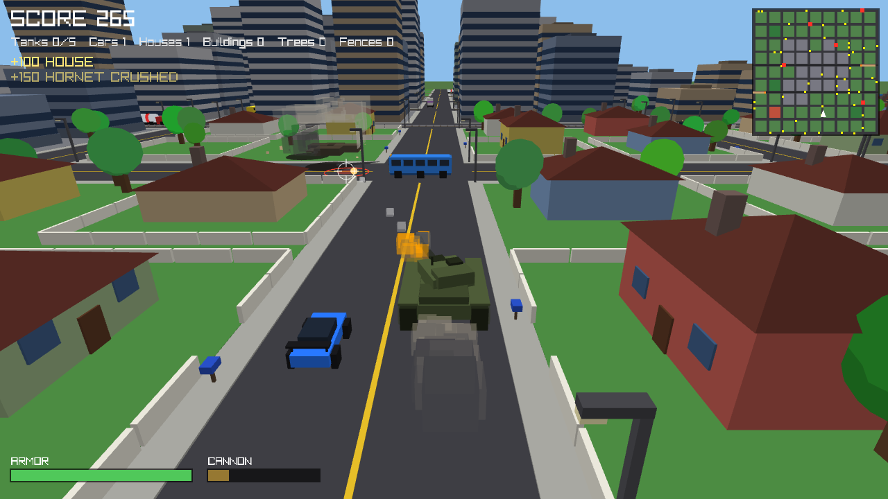
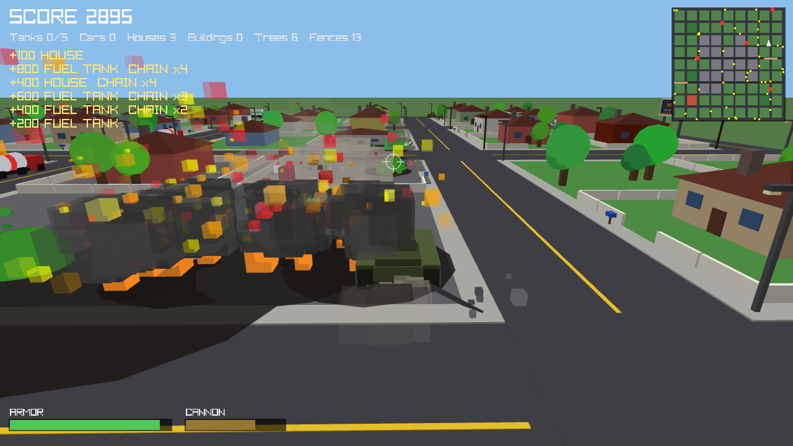
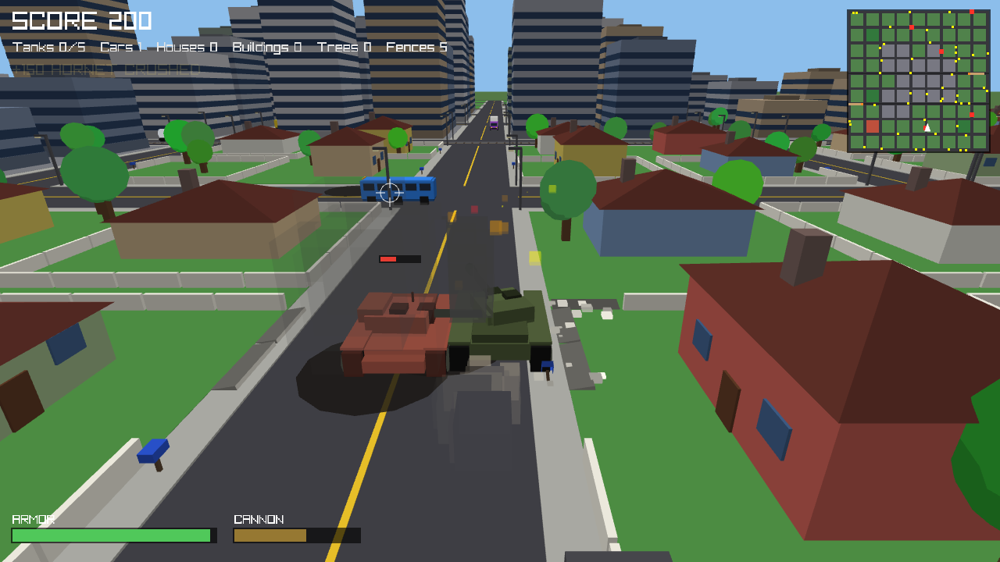
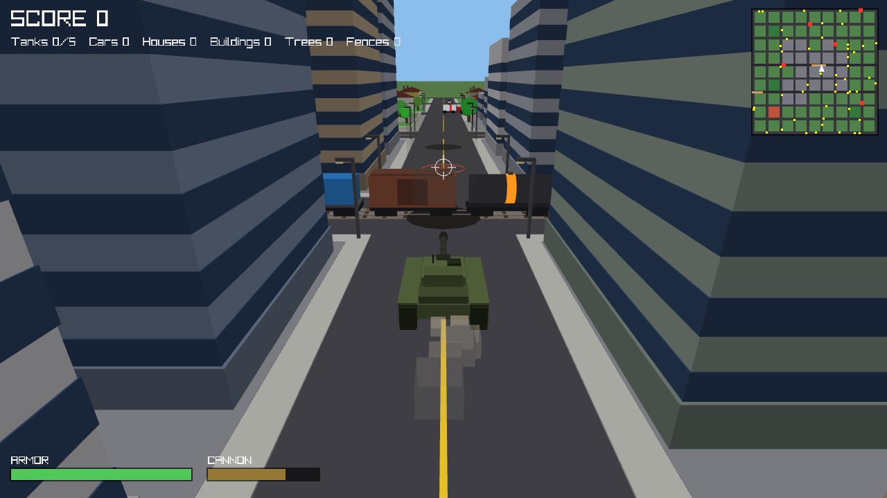
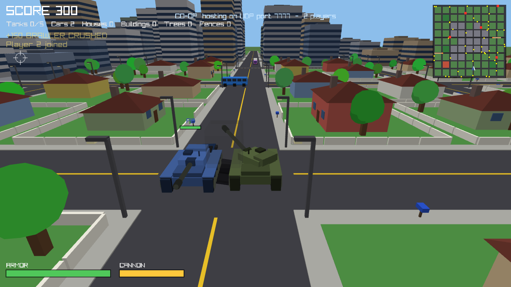
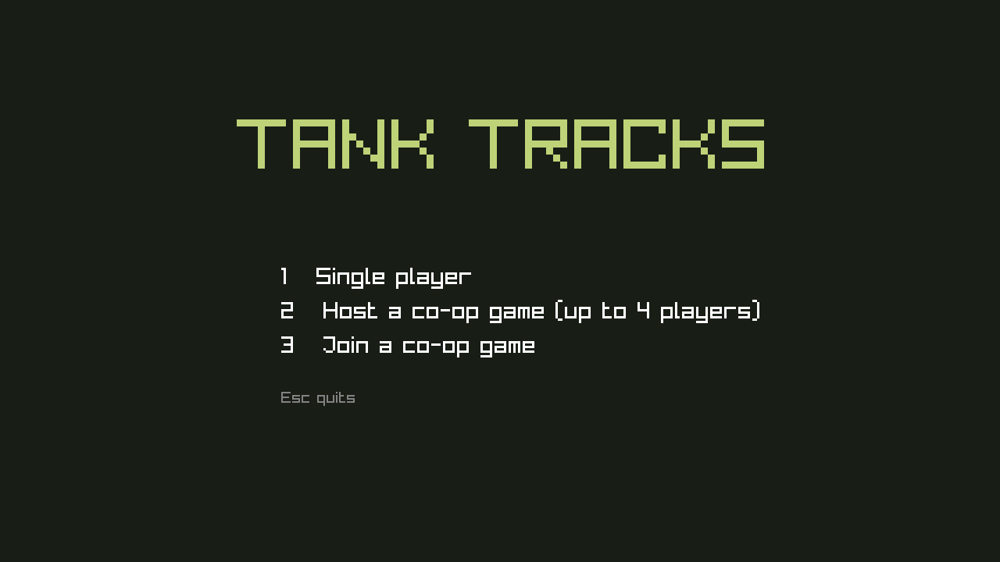
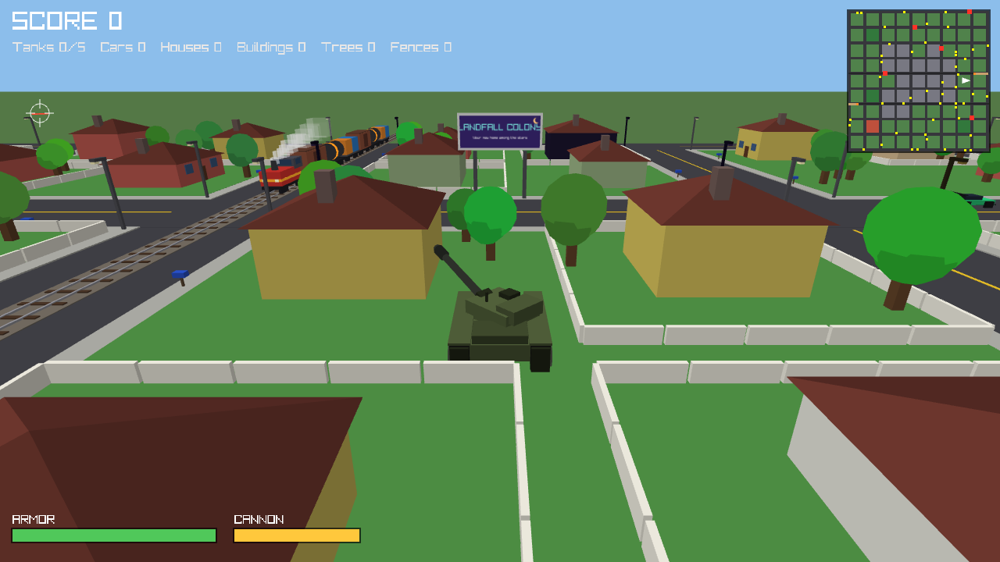

# TANK TRACKS
Drive a tank through a city and shoot everything. C + raylib 5.5. Linux and Windows. 2-4 player co-op.




| Enemy tank | Trains | Co-op |
|---|---|---|
|  |  |  |

| Title screen | Billboards, water towers and trains |
|---|---|
|  |  |

Same engine and build setup as ironroad (`main.c` plus a small `net.c`, no asset files, sound is synthesized).
2-4 player co-op over the network (ENet).

## Download
Prebuilt Linux and Windows binaries are attached to each release (and to every CI run as artifacts).

## Build
```
make && ./tanktracks
```
or `cmake -S . -B build -DCMAKE_BUILD_TYPE=Release && cmake --build build`. raylib and ENet are taken from
`third_party/` if present, otherwise downloaded. `make windows` cross-builds `tanktracks.exe` from Linux
(needs mingw-w64).

## Controls
W/S drive, A/D turn, mouse aims the turret (the cannon shell lands on the red ring),
LMB cannon, RMB or Ctrl machine gun, Q/E look around (it swings back when released), C recenters, mouse wheel zooms, R restart, P pause, Esc quit.

## Targets
Houses, skyscrapers (downtown), trees, fences and lamp posts (crushed by driving over them), water towers (they burst), billboards, fuel tanks and
gas pumps (chain explosions), fire hydrants (geysers), mailboxes, and the ironroad cars (Brawler, Hornet,
Crusher) driving around town. Wrecks burn and sometimes blow up.

Buses, box trucks and fuel tankers share the roads with the cars (a tanker is a rolling bomb). Two trains
run east-west right down the middle of the streets at the 3rd and 6th road rows: a locomotive and six wagons.
They flatten cars at crossings and shove your tank aside, but can be shot to pieces; tank cars explode and
chain down the line. Kill the locomotive and the whole train coasts to a halt; kill a wagon and everything
behind it is stranded. Intact wagons are immovable, but wrecks can be shouldered out of the way (slowly).
Wrecked cars, buses, trucks, tankers and enemy tank wrecks can be shoved aside too, and live buses, trucks
and tankers are too heavy to squash: you push them (small cars still get flattened).
Traffic brakes for tanks, trains and wrecks, and turns around if it stays blocked for 10 seconds.

## Chain reactions
Anything destroyed by a secondary explosion (a fuel tank, tanker, train tank car or exploding wreck) pays a
bonus: x2 for the first link in the chain, x3 for the next, up to x4. The message shows e.g. `+400 HOUSE  CHAIN x4`.

## Enemy tanks
Five red enemy tanks patrol the roads. Within ~110 units they spot you, hunt you down the road grid,
hold at ~70 units and lead their shots. They die to ~3 cannon hits (500 points each); their shells
hurt you much more than your own splash does. Red dots on the minimap, health bars over their turrets.

## Co-op (2-4 players)
One player hosts, the others join. Pick it on the title screen (2 = host, 3 = join: games on your local network are listed automatically, or type the host's address),
or from the command line:
```
./tanktracks --host            # listens on UDP port 7777 (use --host 9000 for another port)
./tanktracks --join 192.168.1.20   # or host:port
```
Everybody fights the same enemy tanks, traffic and trains and shares one score. A destroyed tank respawns
after a few seconds as long as a teammate is still alive; if everybody is down the host presses R to restart.
Your shells splash teammates a little. For play over the internet the host has to forward UDP port 7777
on their router (LAN discovery is a UDP broadcast on port 7778 and only finds games on the same subnet) (or use a VPN such as ZeroTier/Tailscale and join the VPN address).

How it works: the host runs the whole simulation; clients send their controls (30 times a second) and draw the
snapshots the host sends back. The city is generated from a fixed seed on every machine, so only the things that
change travel over the network.
